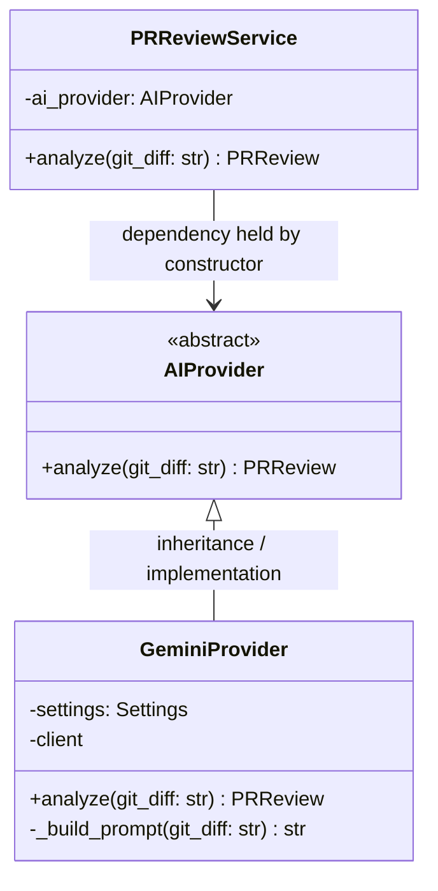
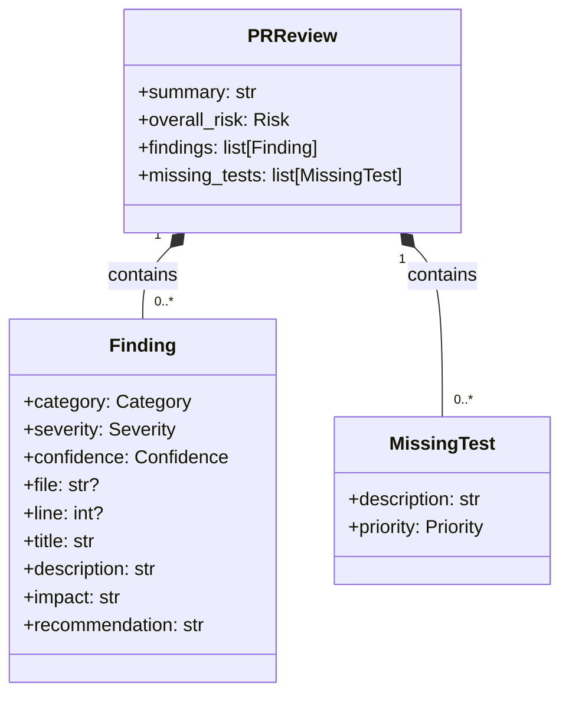
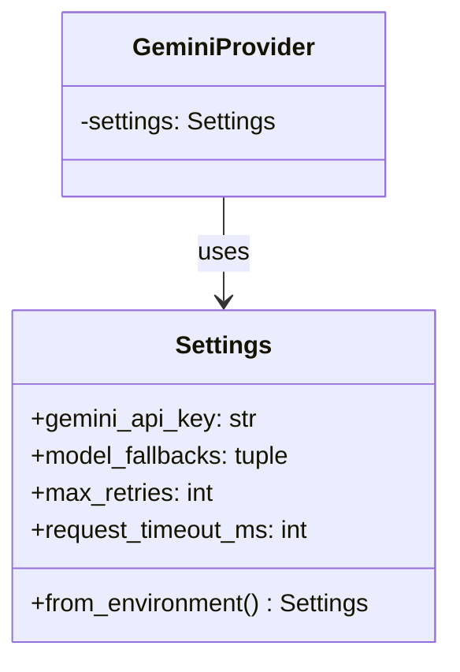

# Class Diagrams

## Purpose

This document explains actual Python classes and their relationships. A module or file is not automatically a class; module-level functions such as `main()` are shown in component diagrams rather than misrepresented as classes.

## Provider abstraction and service

### Relationships

- **Inheritance / implementation:** `GeminiProvider` is a concrete implementation of the abstract `AIProvider` contract.
- **Dependency / has-a reference:** `PRReviewService` receives and stores an `AIProvider` reference through its constructor.
- **Polymorphism:** The service calls `analyze()` through the abstraction without needing to know which concrete provider is supplied.

The service-to-provider relationship is often described informally as composition in application discussions, but the precise UML relationship here is a directed association/dependency: the service holds a reference to an injected provider. The provider is not necessarily owned exclusively by the service.

## Review data model

The `PRReview` model contains collections of findings and missing-test suggestions. The composition notation communicates containment in the response object; it does not imply database lifecycle management.

## Configuration relationship

## Module functions

`app.py` contains module-level functions such as `main()` and `get_review_service()`. `ui/review_page.py` contains functions such as `render_review_page()` and `_render_review()`. They are functions, not classes, and are therefore documented in the component and sequence diagrams.

## Design questions to revisit

If a new evidence model, repository context model, or review policy model is added, update these diagrams to reflect the actual schema and relationships. Do not add planned classes to the current-state diagram before they exist in code.
