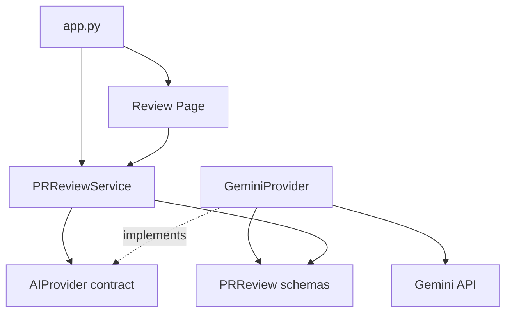

# Component Design

## Purpose

This document explains the responsibilities and collaboration of the current application modules.

## Component map

| Component/module | Main responsibility | Should not own |
|---|---|---|
| `app.py` | Composition root and Streamlit bootstrap | Review rules or prompt details |
| `ui/review_page.py` | Input interaction and rendering | Gemini client construction |
| `services/review_service.py` | PR-review use-case orchestration | Streamlit rendering or SDK calls |
| `providers/base.py` | Provider contract | Provider-specific implementation |
| `providers/gemini_provider.py` | Gemini API integration | Streamlit UI |
| `schemas/review.py` | Review data contracts and validation | API transport |
| `config/settings.py` | Environment-backed configuration | Review orchestration |

## Collaboration

## Design guidance

- Keep presentation concerns in the UI module.
- Keep use-case orchestration in the service.
- Keep SDK and network concerns in provider implementations.
- Keep shared response types in schemas.
- Construct concrete dependencies at the application composition root.
- Prefer the smallest design that satisfies a real requirement.

## Current trade-off

`PRReviewService` is intentionally small today. It establishes a use-case boundary and centralizes input validation/delegation. If it remains a pure pass-through as the product evolves, reassess whether the extra layer still provides value.
