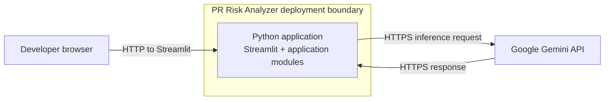

# Container Design

## Purpose

This document uses the C4 notion of a container to describe independently runnable applications or data stores within the system boundary.

## Current deployment shape

The current implementation has one application container: the Python application running Streamlit. The Gemini API is an external system, not a container owned or deployed by this project.

## Why this is not a microservices architecture

The UI, service, provider, and schemas are Python modules in one application. They are not separately deployed services and do not communicate over internal network APIs.

## Runtime configuration

The application reads its Gemini API key and model/retry settings from configuration. Keep secrets outside source control.

## Possible future containers

Only introduce additional deployable units when requirements justify them. Examples might include a persistent database or background worker if review history or asynchronous large-diff processing is implemented. These are not part of the current deployment.
