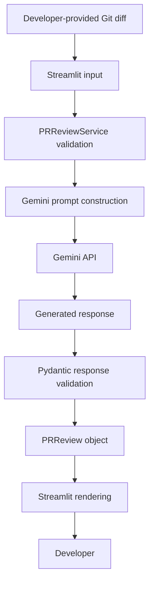

# Data Flow

## Purpose

This document follows the data entering, moving through, and leaving the PR Risk Analyzer.

## High-level flow

## Data stages

1. **Input:** The developer pastes a textual Git diff.
2. **UI validation:** The UI rejects blank input before calling the service.
3. **Use-case validation:** `PRReviewService` independently rejects blank input.
4. **Prompt construction:** `GeminiProvider` combines review instructions and the supplied diff.
5. **External processing:** The prompt is sent to the configured Gemini API model.
6. **Response validation:** The response is parsed and validated against the `PRReview` Pydantic model.
7. **Presentation:** The UI renders summary, risk, findings, and missing tests.

## Trust boundaries

- User-supplied diffs are untrusted input.
- AI-generated responses are untrusted until parsed and schema-validated.
- Schema validation checks shape and types; it does not establish factual correctness.
- The external AI provider receives source-code content. Review privacy and data-handling requirements before sending sensitive code.

## Data not currently persisted

The current application does not store review history in a database. Review data is used for the current interaction and displayed in the Streamlit session.
