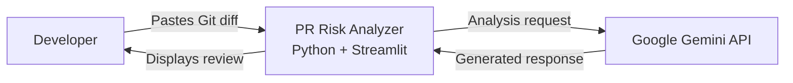
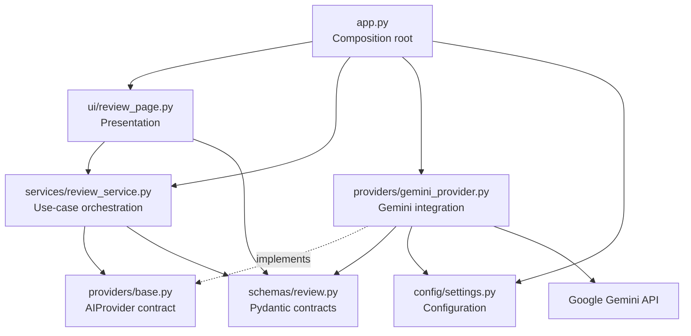
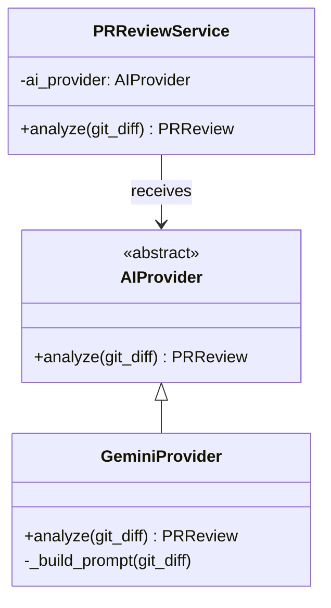
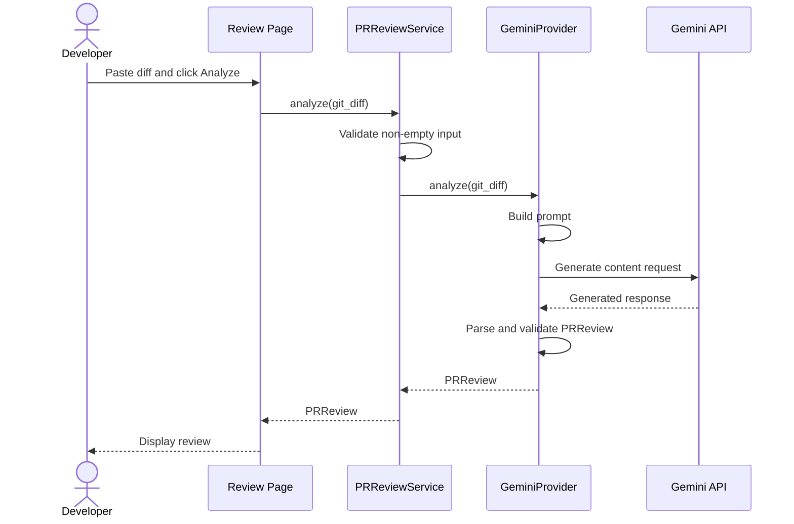

# Architecture Overview

## 1. Purpose

PR Risk Analyzer is a small AI-assisted code-review application. A developer supplies a Git diff, the application asks a configured AI provider to analyze it, validates the structured response, and displays the result.

This document describes the architecture that exists today. It does not describe planned GitHub integration, persistence, multiple deployed services, or repository indexing as implemented capabilities.

## 2. Architectural style

The current system is a **single Python application with modular, layered responsibilities**.

It is not a microservices system. The folders are logical code boundaries within one application.

| Area | Current responsibility |
|---|---|
| Presentation | Streamlit input and result rendering |
| Application | Orchestrates the PR-review use case |
| Provider integration | Calls the external AI service |
| Schemas | Defines and validates review data |
| Configuration | Loads runtime settings |

## 3. System context



The developer manually supplies the diff. The application does not currently fetch pull requests or repository contents from GitHub.

## 4. Logical component architecture



The diagram shows logical dependencies, not separate deployable processes.

## 5. Module responsibilities

### `app.py`

The application entry point and composition root. It configures Streamlit, creates the concrete provider and service, and passes the service to the UI.

### `ui/review_page.py`

Owns Streamlit interactions: accepting a diff, invoking the service, and rendering the result. It should not construct Gemini clients or contain provider-specific logic.

### `services/review_service.py`

Contains the `PRReviewService` use case. It validates the diff and delegates analysis through the `AIProvider` abstraction.

### `providers/base.py`

Defines the provider contract. Concrete providers must implement the required analysis operation and return the shared review model.

### `providers/gemini_provider.py`

Implements the provider contract using the Google Gen AI SDK. It owns prompt construction, provider communication, model fallback/retry behavior, and response parsing.

### `schemas/review.py`

Defines Pydantic models such as `PRReview`, `Finding`, and `MissingTest`. These models form the structured response contract shared across modules.

### `config/settings.py`

Loads configuration from environment variables and exposes settings such as the API key, model fallback sequence, retry count, and request timeout.

## 6. Dependency direction and object construction

`PRReviewService` depends on `AIProvider`, not directly on `GeminiProvider`. The concrete provider is constructed in `app.py` and injected into the service.



This gives the service a stable contract and allows tests to supply a fake provider.

## 7. Runtime flow



## 8. Data contracts

The current response structure is conceptually:

```text
PRReview
├── summary
├── overall_risk
├── findings: list[Finding]
│   ├── category
│   ├── severity
│   ├── confidence
│   ├── file
│   ├── line
│   ├── title
│   ├── description
│   ├── impact
│   └── recommendation
└── missing_tests: list[MissingTest]
    ├── description
    └── priority
```

Pydantic validates structure and types. It does not prove that an AI-generated finding is factually correct; findings still require engineering verification.

## 9. Testing approach

The service is tested using a fake implementation of `AIProvider`. This verifies service behavior without network access, API credentials, or quota usage.

Current service tests cover successful delegation, empty input rejection, and propagation of provider failures. Provider-specific retry and fallback tests are a separate concern.

## 10. Current limitations

- The developer supplies diffs manually.
- Only Gemini is currently implemented.
- No review persistence or history exists.
- No GitHub integration exists.
- The application does not retrieve broader repository context.
- The UI is implemented with Streamlit.
- AI findings can be incomplete or incorrect.

## 11. Evolution guidelines

Add complexity only when a concrete requirement justifies it. For example, GitHub integration may justify a new integration module; review history may justify persistence. Do not introduce queues, microservices, repositories, factories, or abstractions merely because they are common in larger systems.

When a change affects module responsibilities, dependency direction, data contracts, runtime flows, security, or setup, update the relevant diagrams and documentation.

## Related documents

- [System Context](system-context.md)
- [Container Design](container-design.md)
- [Component Design](component-design.md)
- [Class Diagrams](class-diagrams.md)
- [Sequence Diagrams](sequence-diagrams.md)
- [Data Flow](data-flow.md)
