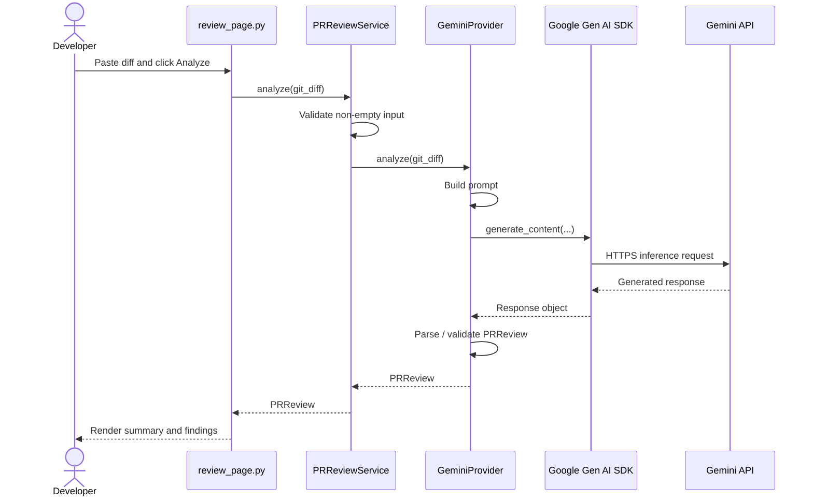
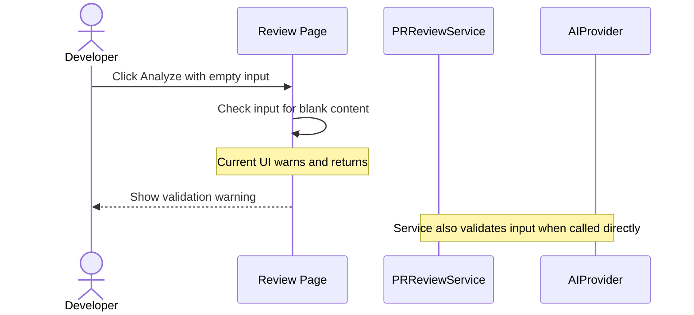
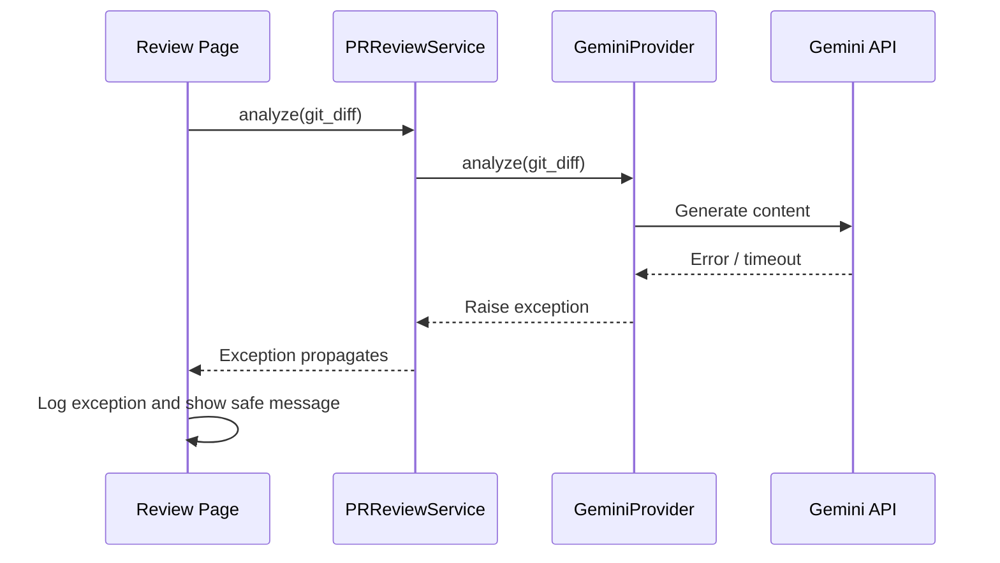

# Sequence Diagrams

## 1. Successful review

## 2. Empty input

The UI currently performs a blank-input check before invoking the service. The service repeats validation as a use-case boundary so callers other than the UI cannot bypass it.

## 3. Provider failure

Exact retry and fallback behavior is implemented in the provider and may change. Keep this diagram synchronized with the actual exception-handling implementation.
