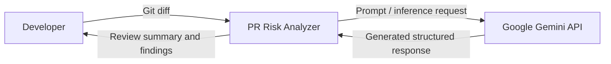

# System Context

## Purpose

This document defines the boundary of the current PR Risk Analyzer and its external actors.

## Actors and external systems

| Actor/system | Role | Current interaction |
|---|---|---|
| Developer | Uses the application | Pastes a Git diff and reads the review |
| PR Risk Analyzer | System being built | Validates input, orchestrates analysis, displays output |
| Google Gemini API | External AI service | Receives the prompt and returns a generated response |

## Context diagram

## System boundary

Inside the boundary:
- Streamlit user interface
- PR review application service
- AI provider implementation and abstraction
- Pydantic review contracts
- Runtime configuration

Outside the boundary:
- Developer's source repository
- Google Gemini API
- Developer's local environment and API credentials

## Important security and privacy note

A Git diff may contain proprietary source code, credentials, or personal data. Users should inspect and sanitize diffs before submitting them. They should review the configured AI provider's data-handling terms and their organization's policies before sending code externally.

## Not currently in scope

The application does not currently connect to GitHub, clone repositories, fetch pull-request metadata, or store review history. Those are possible future integrations, not current context relationships.
