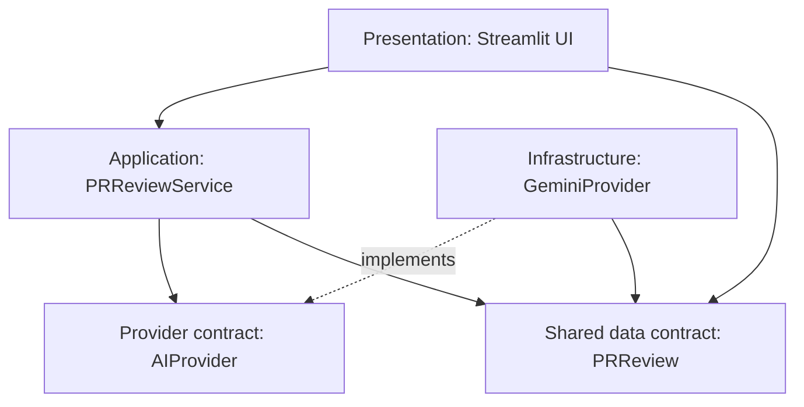

# Clean Architecture: Practical Application

## What we mean in this project

The project uses separation of concerns and an abstraction at the AI provider boundary. It is a small modular application inspired by clean-architecture ideas; it is not a complete implementation of every Clean Architecture layer or pattern.

## Current logical flow

## Dependency rule at the provider boundary

The application service depends on the provider abstraction. Provider-specific SDK details remain in the infrastructure implementation.

## What is intentionally absent

The current application does not have a separate domain package, repository layer, database, message broker, or microservices. These are not automatically required for a small application.

## When to evolve

Introduce additional boundaries when requirements create meaningful reasons: persistence, GitHub integration, background processing, multiple provider-selection policies, or more complex review workflows.

The goal is maintainability, not architectural ceremony.
